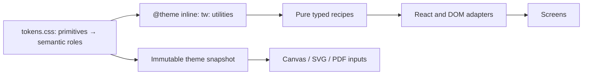

# Design system

`src/design-system/tokens.css` is the authored design-value source. It defines primitive
pigments, shared theme-independent roles and complete varying semantic mappings for `night-paper`, `parchment`, and `velvet`, the
orthogonal Revival type preset and Tailwind's semantic adapter.
The system preserves the existing appearance; owner decisions in AICAP-28 remain pending.

## Add a token

1. Reuse the role for the same purpose and rendered value. Names describe a purpose:
   `--ds-space-control`, `--ds-radius-card`, `--ds-control-height-touch`, `--ds-stroke-focus`,
   `--ds-layer-dialog`. Rule numbers, selector indices, and values in names are forbidden.
   Equal values serving the same role are one token. Preserve different values under distinct
   names while an owner decision is pending; never normalize appearance as part of a rename.
2. The core spacing scale is `none`, `hairline`, `micro`, `compact`, `snug`, `small`, `control`,
   `content`, `section`, `panel`, `page`, `stage`. Existing density roles such as `tight`,
   `inline`, `row`, `action`, and `heading` compose that scale. Zero-spacing utilities use
   `flush` (`tw:p-flush`), leaving native `max-w-none` / `max-h-none` limits intact.
   Position roles such as `center` do not reuse a radius merely because the values match. Radii use `field`, `track`,
   `control-dense`, `media`, `indicator`, `tile-dense`, `menu`, `control`, `icon`, `segment`,
   `card`, `tile`, `card-roomy`, `dialog`, `dialog-roomy`, `sheet`, `pill`, and `round`.
   D08/D10 retain distinct control/card densities; D12 retains the dialog/sheet distinctions.
3. Define shared dimensions, type metrics and motion once on `:root`. Define every display
   paint, including pigments mapped to renderer roles, gradients, glows, shadows and transparent
   materials, in **every theme block** with identical key sets. Equal values across themes are
   intentional parity mappings. Only `print-paper` and `print-ink` are theme-independent paint
   exceptions: D18 keeps exported engraving independent of the display theme. Private
   `--pigment-*` declarations are ingredients, not component APIs.
4. Expose an ordinary property through `@theme inline` and use complete semantic classes such
   as `tw:p-control tw:rounded-card tw:text-ink tw:border-rule tw:z-dialog`.
   `tw:p-control` uses the authored spacing role, not Tailwind's numeric default scale.
   The prefix precedes variants: `tw:hover:bg-surface-hover`. The default theme namespaces
   are reset. Full background/font/border/transition shorthands and raw authored shadow lists
   use the small semantic `surface-*`, `type-*`, `frame-all-*`, `motion-*`, and `elevation-*`
   helpers because those shorthands cannot be expressed by an ordinary theme namespace.
   Never create a selector-specific utility or a utility/variant numbered after a rule.
5. Renderer inputs stay in the snapshot contract even when no utility consumes them.
   `fontRoles`, spectrum families and dynamically selected material roles are public consumers;
   a text search alone cannot prove their tokens unused. Extend `colorRoles`/`fontRoles` in
   `theme/index.ts` when adding concrete renderer colors/fonts. `readTheme().roles` contains
   every authored role. Run the guard, typecheck and relevant unit/browser checks.

## Add a theme or preset

Add one complete varying-role block in `tokens.css` and one entry in
`theme/resolver.js`'s `themeRegistry` (ID, label, aliases, storage key, title start and menu
policy). Color scheme comes from the token block. Copy an existing block to retain the
complete key set, then change role values there: player disc, selected pills, voice materials,
library cover ground, sheens and renderer effects are included. Shared roles supply geometry
and typography; they do not hide an extra display palette. Existing translated labels remain;
`menuLabel: null` keeps Velvet URL-only. New entries can use their registry label.

Components never select a theme ID. CSS material recipes query `material-family` and
`color-scheme`; renderers consume the typed `material-strategy` role for paper kind and
ink/light compositing independently of the browser scheme. A new theme chooses those
roles in its block. Revival is an orthogonal `data-type` preset declared solely in `tokens.css`:
it overrides typography roles used by the same recipes without component selectors.

`npm run test:browser:theme-extension` injects one test-only block and registry entry, strongly
rotates all resolved display paints, and checks actual element paints and canvas pixels across
main screens and renderers. Keep this loud-theme check as well as the three-theme parity
matrix: complete token keys alone do not prove that a component consumes its theme roles.
No fourth theme ships in production. Print colors remain stable under D18.

The self-contained resolver's raw source, including its registry/helpers, is injected before
hydration; Vite uses the identical serializer for the offline shell. Do not serialize compiled
functions. JS literal inference supplies the public types; no hand-maintained theme union or
second declaration registry exists. The resolver remains safe to import on the server.

Use `setThemePreference('system' | 'night-paper' | 'parchment' | 'velvet')`. Existing device
URLs/storage (`papier`, `pergament`, `samt`, `auto`) remain compatible. Explicit choice wins
over OS appearance. `data-theme` chooses the colors; `data-type` selects the orthogonal
Revival preset. Only `data-theme` selects the theme; `data-start`/`data-title` are independent title drafts.

`readTheme()` is client-only and returns a deeply frozen snapshot with a revision, concrete
sRGB colors, resolved font stacks, spectrum/fallback, material and print roles. Imports are
SSR-safe. It reads each role with `getPropertyValue` using `theme/roles.generated.ts`, generated
from `tokens.css` by the Vite build/watch plugin; the regression test checks exact equality.
It never relies on CSSStyleDeclaration custom-property enumeration. Load the eager CSS first.

Theme API:

- `subscribeTheme(fn, { immediate: true })` delivers the current snapshot and subsequent revisions;
  dispose the returned function. Without `immediate`, delivery starts on the next change.
- `getThemeRevision()` is a cheap key without allocating a snapshot or reading token styles.
- `memoizeByTheme(theme => resource)` returns a zero-argument getter caching one resource per
  revision. Keep one getter per resource; dispose external resources in the owning consumer.
- `theme.color('accent').rgba(alpha)` and `.withAlpha(alpha)` multiply the role's existing alpha;
  `.rgba()` returns a CSS string, `.withAlpha()` a frozen Color. Existing `theme.colors` remains.
- React imports `useTheme` from `design-system/theme/react`; it returns `undefined` during SSR
  and initial hydration, then the cached client snapshot through `useSyncExternalStore`.
- Runtime material writers update their distinct live input, then call
  `notifyThemeMaterialChange()` to invalidate the snapshot/revision and notify subscribers.
  The generated paper texture is a CSS output and does not publish a semantic revision.

Cached reads do not poll DOM attributes; the preference API invalidates synchronously and the
attribute observer handles external attribute edits at its next delivery. Subscriber errors
are isolated with `reportError`; nested invalidation continues the current pass with the
latest snapshot for remaining listeners. There is no quiet-moment preference override API.

Reuse one snapshot per drawing frame; never read computed styles per note. Renderer caches compare revisions; see `renderer-themes.md`. Verify actual playback swaps as
well as the showcase.

Only width thresholds occupy `--breakpoint-*` in the static `@theme` block. The landscape height
is `--viewport-short-landscape-height`, consumed by `theme()` without creating a width variant.
JS uses `breakpoint()` (always a px string; rem converts using root font size) /
`matchBreakpoint()`; `below` preserves strict `<` and `max` inclusive `<=`.
Use `matchBreakpoint('panel', 'below')` / `tw:max-panel:`; there is no `panel-max` token.
Read breakpoints lazily after CSS loads. Notation geometry and measured popup/drag positions
remain in their existing modules.

## Add a component

Start with an existing primitive (`Button`, `Field`, `Dialog`, `Card`, `Menu`, and their DOM
builders) when its semantics fit. Both adapters use the same pure recipe. Add a named variant
for an actual density, intent or focus difference; do not patch a completed class string.
For a domain composition, put typed named slots under `design-system/recipes/` and combine
those primitives. For example `transportRecipe`, `voiceRowRecipe`, `libraryDialogRecipe`,
`libraryHeaderRecipe`, `transcriptionJobRecipe` and `ensemblePanelRecipe` centralize their
component roles. Unknown slot/variant keys must fail typechecking.

Structural containers use `appShellRecipe().root` or a named header/stage slot explicitly at
construction. These native containers inherit their parent typography. Primitive controls
normalize their own slots with `ds-reset`; global Preflight is deliberately omitted. Keep
stable IDs, classes, `data-action` and `data-bind` hooks as behavior contracts, independently
of the selected recipe. Never interpret a bag of hook strings to discover appearance.

Recipes are framework-free TypeScript with complete literal semantic `tw:` strings. They may
import other recipes and type-only token/theme declarations. Runtime theme, React, DOM and
application imports are forbidden, including through re-exports. React and DOM builders own
native semantics and lifecycle; recipes own visual roles and explicit variants.

`app.css` is the CSS/font foundation: `theme → fonts → tokens → native → components → utilities`.
It contains imports and Tailwind directives/mappings, with no ordinary component selectors.
There is no legacy layer or legacy stylesheet. `recipes/shell.ts` supplies native route/domain
composition at construction; `dom/main-screen.ts` attaches ID/class slots without DOM scanning.
`native.css` retains global inheritance, generated grounds and native subparts; `stage.css`
retains canvas sizing/compositor hooks; `artwork.css` retains keyframes and the typed ink
interpolation registration. Every retained rule states its reason. Other component CSS is
limited to native/generated parts. Keep element-local inputs (`--written`, `--ded-wait`, voice
colors and measured positions) at their consumer: hoisting their expressions to root freezes
or invalidates them. Their authored dimensions/timings still come from `tokens.css`.

Production `design-css-split.mjs` restricts the foundation’s utility candidates to shared/auth/admin
recipes. `workspace.css` emits the app’s library/account/player/panel residue and ordered utilities
from that same source. `/app` SSR links it eagerly after the foundation, before hydration; the
offline shell links both in that order and the finalized service-worker manifest precaches both.
Common utilities repeat in the app output to retain Tailwind’s global ordering when primitive
and area classes compete. Development `app.css` remains the full catalog entry. See ADR 0005.

Base controls/display/overlay factories accept pure typed extensions. `app-*` recipe modules
compose those factories with the area recipes. React’s default adapter uses base recipes; DOM
and the development `react/app` adapter use app composition. Adapter implementations and part
contracts are shared factories, with no mutable registry. Do not import app recipes from the
base factories, auth adapter or behavior helpers (including indirect part imports).

Root SSR and the offline shell link the generated stylesheets before startup. The finalized
service-worker asset manifest includes CSS/fonts and the generated favicon. Browser-installed
SVG/manifest sources live under `design-system/assets`; `scripts/design-assets.mjs` resolves
their default-theme roles for development and builds because external icons cannot inherit
page CSS. Raster brand artwork remains fixed asset data.

The dev-only `/dev/design-system` route renders the palette, spectrum and fonts and offers
the switcher and shared React/DOM component comparisons. Its module/route are eliminated
from production.

## Guard: zero baseline

`npm run check:design-utilities` loads the full app.css entry through the pinned Tailwind
compiler and checks every authored `tw:` candidate in src TypeScript/TSX literals. A candidate
that emits no CSS fails, with source locations; `tw:peer` is the intentional selector marker.
This catches unsupported named scales, missing variants and dead utility aliases. Unit tests
also check emitted and computed focus offsets and include absent-utility negative controls.

`npm run check:design-tokens` uses TypeScript and PostCSS ASTs. It checks source CSS/TS/JS,
server presentation and authored public SVG/manifest assets. It flags literal colors
(including named colors, template RGB channels and local tuple/channel flow to visual
sinks), font stacks, default-palette/font utilities, arbitrary aesthetic utilities,
screen-context control selectors and forbidden recipe imports. Font/font-family declarations and canvas/style font sinks use an allowlist: a variable,
inherit/initial, or snapshot font (with tokenized sizing in shorthand). Named-color identifiers
are checked throughout CSS values and style/cssText/setProperty/canvas sinks, skipping url(),
var(), font-family, animation-name and content. Recipe dependencies use an allowlist. Outside the system, computed custom-property reads and direct viewport breakpoint comparisons
are rejected. Theme/type selectors belong only in tokens.css; attribute reads belong in the
canonical theme runtime. Raw media/custom-variant breakpoints are checked in system CSS too.
Every CSS import, including app.css imports, needs layer(); root's eager app.css?url link is
the explicit TypeScript boundary. Arbitrary utility values require semantic variables (including
Tailwind type hints and token-only expressions); use named adapter scales first. Native cascade
keywords and the documented local geometry/material inputs below are structural exceptions.
Numeric design-scale utilities require explicit authored token mappings. Rule-index and
value-encoding names are rejected for tokens, utilities and variants. Shared screen paint
belongs in complete theme blocks; only dedicated print paper/ink remain fixed (D18).

Geometry triples alone and measured popup/drag positioning are permitted. This is conservative
local AST/lexical analysis, **not a security boundary** or an interprocedural color-flow proof.
Concatenated/joined strings, cross-module/object-field channels, aliased or reflective DOM
access and arbitrary data flow are not exhaustively resolved. Snapshot-font recognition follows
local `.fonts` access and aliases, not a whole-program type proof. Review renderer inputs and
external SVG output. Do not interpret a green guard as proof of complete theme reactivity.

`scripts/design-token-baseline.json` must contain zero entries. Any non-empty baseline fails,
even when it exactly matches current source. Initialization and merge-new-rules switches are
retired. Fix a violation at its source. Design-system CSS outside `tokens.css` also rejects raw
length/duration literals (including px/rem/em/ms/s/%); zero and 100% are allowed. Token variables
and token-backed calculations are the normal representation. Legacy theme-attribute selectors
are forbidden. Named exceptions are structural rules with reasons, never baseline entries.

`files()` scans authored CSS/TS/JS under src/ and server/, plus public SVG/webmanifest assets.
It skips generated routeTree files and test files, and does not enter scripts/, node_modules/,
build outputs or repository-root index.html/vite.config.ts. These are tooling, generated/test
fixtures and bootstrap/build plumbing rather than product presentation; their emitted CSS /
SSR/offline delivery are covered by build and browser contracts. This scope is a real limit,
so review new presentation-producing tooling and root HTML explicitly.

Named narrow exceptions:

- Native cascade keywords (`inherit`, `revert`, `initial`, `unset`, `none`) select inheritance
  or structure rather than author a new design value. The typed font compiler utility reads
  `--type-*` mappings, whose authored source remains tokens.css.
- Token-backed material expressions may consume local `--c` (voice paint), `--rx`/`--ry`
  (pointer tilt), and `--written`/`--ded-delay`/`--ded-wait` (writing progress/delay).
  Generated table labels may use `content-[attr(data-label)]`.
- `paper-noise-geometry`: only formation/flocs/tooth noise tuples in `paper.ts`, interpreted as
  cell counts and amplitude; color tuples at other sinks still fail.
- `notation-stem-shape`: `black` in the existing filled/half stem-shape conditional, not paint.
- `document-white-flattening`: the exact Sharp background property in document preprocessing,
  before grayscale; unrelated to screen or PDF appearance.
- `ink-interpolation-registration`: `@property --written` requires a constant initial percentage;
  108% is completed writing geometry. Its syntax string is CSS registration metadata.

Bundled `@font-face` identities register assets rather than choose stacks. `safe-svg.ts`'s
expected Verovio cursor stylesheet remains exempt by its exact SHA-256; do not relax the sanitizer.
The guard is local AST analysis with the limitations above, not an interprocedural proof.

## Parity roles retained

| Family | Distinct roles retained for current appearance |
| --- | --- |
| DOM/canvas grounds | `surface-sunken/surface/raised/overlay/hover` vs `canvas-surface-sunken/surface/raised/overlay`; `score-stage-top/middle/bottom`; material sheet/card grounds |
| Gold accents | `accent/focus`, `admin-accent`, `transcription-accent`, `accent-offline`, `accent-invitation`, `score-query`, voice 3 / feedback idea; the historical admin system surface remains a named input though its erroneous OS override is removed |
| Gold materials | `material-gold-deep/mid/light` vs `material-wordmark-gold-deep/mid/light`, plus `material-gold-leaf`; stop positions remain separate |
| Ink / whites | `ink`, `material-wordmark-ink`, `score-key-light`, warm/hot light, reading-strip lamp vs `material-paper-lamp`, fibre light/ink |
| Type | DOM body/mono/display/heading/song-title, shorter auth/admin/transcription stacks (`font-auth-*`), canvas text/mono/display, mark/brand/script/music; Revival does not silently change auth/admin or canvas text |
| Controls / spacing | 42px legacy control vs 44px auth/admin/transcription heights; compact controls; existing space scale and score ruler height |
| Radii | Legacy control/card/dialog, square field, admin control, transcription tile/card/dialog, sheet/menu/chip/round |
| State | Disabled base/admin/auth/offline and dimmed-voice opacities remain separate |
| Effects / motion | Material emboss vs menu/admin/focus shadows; switch/fast/normal/slow and transcription/dedication timings; distinct stacking contexts |
| Display / print | Display ink/fonts versus stable print paper/ink and LiberationSerif / LightScoreEngraving asset identities; engraving is unchanged |

The old offline marker fallback is explicitly mapped to `accent-offline`, so introducing a
complete default accent fixes focus without recoloring that marker. `paper.ts` writes its
procedural texture to `--ds-material-fibre-live` and notifies the controller. Paper-theme
`material-fibre` roles use that live input with the authored SVG fallback; velvet keeps `none`.
Material recipes and the renderer accessor consume the chosen semantic role directly.

## Verification

Run `npm run typecheck`, `npm test`, `npm run build`, `npm run check:design-tokens`,
`npm run check:design-utilities`,
`npm run test:browser:design-system`, `npm run test:browser:theme-extension`,
`npm run test:browser:renderer-themes`, and the isolated authentication/admin browser suites.
Set `BROWSER_EVIDENCE` to an external evidence directory when collecting captures. CI runs the
reusable contracts. `npm run test:design-mutants` proves the regression checks reject the
review mutations without editing checkout files. Production-built browser checks cover auth, library, roll, staff, ensemble
and account sheets, transcription and admin; renderer checks also compare live token edits
against fresh instances. The repository currently has no ladder `docs/agents/verify.md` or
`check:fast`/`check:full`/`verify:app` contract; these commands do not claim those rungs.

Primitives, parity decisions, adapter examples and browser-check APIs:
[design-primitives.md](design-primitives.md).

### Administration link

`account-link` preserves Chromium’s former dark native link color (`rgb(158,158,255)`)
for Night paper and Velvet. Parchment deliberately uses its accent link color instead of
the native blue (`rgb(0,0,238)`); this is the sole visible P6d cleanup change.
The color is a complete theme role, so added themes can choose their own link paint.

### Material strategy

Each theme authors `--ds-material-strategy: light | ink`, independent of its browser
`color-scheme`. The typed snapshot maps `light` to device-selected paper, source-over
lanterns and additive ribbons; `ink` to pergament, multiplied lanterns/glows and
source-over ribbon lines. Night paper/Velvet select `light`; Parchment selects `ink`.
These roles preserve the previous pixels without using browser scheme as a material policy.
