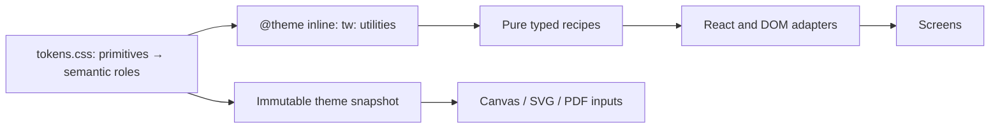

# Design system

`src/design-system/tokens.css` is the authored design-value source. It defines primitive
pigments, shared theme-independent roles and complete varying semantic mappings for `night-paper`, `parchment`, and `velvet`, the
orthogonal Revival type preset and Tailwind's semantic adapter.
AICAP-28 owner decisions now unify the foundation families; the decision contract below supersedes historical parity guidance for those roles.

## Add a token

1. Reuse the role for the same purpose and rendered value. Names describe a purpose:
   `--ds-space-control`, `--ds-radius-card`, `--ds-control-height-touch`, `--ds-stroke-focus`,
   `--ds-layer-dialog`. Rule numbers, selector indices, and values in names are forbidden.
   Equal values serving the same role are one token. Preserve different values under distinct
   names while an owner decision is pending; never normalize appearance as part of a rename.
2. Component tokens compose spacing, radius, size/type, leading, tracking and stroke scales.
   A raw length is forbidden when an equal scale step exists (including inside shorthands,
   shadows, transforms and theme paints). Preserve units: rem/em roles retain their relative
   behavior. Equal element metrics with the same purpose share a role; zero geometry uses
   `space-none` / `flush`, while zero line height uses unitless `leading-none`.
   Custom-property names are at most 48 characters including `--` and never contain another
   `--`. Short role names replace selector paths; numeric ordinals are not component roles.
   `design-token-policy.mjs` and the guard enforce these constraints.
   Standalone unitless zero in geometric shorthands also composes `space-none` or
   `radius-none`. Unitless arithmetic inputs (such as normalized card tilt at rest),
   opacity and color channels retain their numeric grammar instead of taking a length role.

   The core spacing scale is `none`, `hairline`, `micro`, `compact`, `snug`, `small`, `control`,
   `content`, `section`, `panel`, `page`, `stage`. Existing density roles such as `tight`,
   `inline`, `row`, `action`, and `heading` compose that scale. Zero-spacing utilities use
   `flush` (`tw:p-flush`), leaving native `max-w-none` / `max-h-none` limits intact.
   Position roles such as `center` do not reuse a radius merely because the values match. Radii use `field`, `track`,
   `control-dense`, `media`, `indicator`, `tile-dense`, `menu`, `control`, `icon`, `segment`,
   `card`, `tile`, `card-roomy`, `dialog`, `dialog-roomy`, `pill`, and `round`.
   D08/D10 retain distinct control/card densities; D12 uses centered dialog geometry; active compatibility names retain their own content widths.
3. Define shared dimensions, type metrics and motion once on `:root`. Define every display
   paint, including pigments mapped to renderer roles, gradients, glows, shadows and transparent
   materials, in **every theme block** with identical key sets. Equal values across themes are
   intentional parity mappings. Only `print-paper` and `print-ink` are theme-independent paint
   exceptions: D18 keeps exported engraving independent of the display theme. Private
   `--pigment-*` declarations are ingredients, not component APIs.
4. Expose an ordinary property through `@theme inline` and use complete semantic classes such
   as `tw:p-control tw:rounded-card tw:text-ink tw:border-rule tw:z-dialog`.
   `tw:p-control` uses the authored spacing role, not Tailwind's numeric default scale.
   The prefix precedes variants: `tw:hover:bg-surface-hover`. The default theme namespaces
   are reset. Full background/font/border/transition shorthands and raw authored shadow lists
   use the small semantic `surface-*`, `type-*`, `frame-all-*`, `motion-*`, and `elevation-*`
   helpers because those shorthands cannot be expressed by an ordinary theme namespace.
   Never create a selector-specific utility or a utility/variant numbered after a rule.
5. Renderer inputs stay in the snapshot contract even when no utility consumes them.
   `fontRoles`, spectrum families and dynamically selected material roles are public consumers;
   a text search alone cannot prove their tokens unused. Extend `colorRoles`/`fontRoles` in
   `theme/index.ts` when adding concrete renderer colors/fonts. `readTheme().roles` contains
   every authored role. Run the guard, typecheck and relevant unit/browser checks.

## Add a theme or preset

Add one complete varying-role block in `tokens.css` and one entry in
`theme/resolver.js`'s `themeRegistry` (ID, label, aliases, storage key, title start and menu
policy). Color scheme comes from the token block. Copy an existing block to retain the
complete key set, then change role values there: player disc, selected pills, voice materials,
library cover ground, sheens and renderer effects are included. Shared roles supply geometry
and typography; they do not hide an extra display palette. Existing translated labels remain;
`menuLabel: null` keeps experimental Velvet out of the main appearance choices. New entries can use their registry label.

Components never select a theme ID. CSS material recipes query `material-family` and
`color-scheme`; renderers consume the typed `material-strategy` role for paper kind and
ink/light compositing independently of the browser scheme. A new theme chooses those
roles in its block. Revival is an orthogonal `data-type` preset declared solely in `tokens.css`:
it overrides typography roles used by the same recipes without component selectors.

`npm run test:browser:theme-extension` injects one test-only block and registry entry, strongly
rotates all resolved display paints, and checks actual element paints and canvas pixels across
main screens and renderers. Keep this loud-theme check as well as the three-theme parity
matrix: complete token keys alone do not prove that a component consumes its theme roles.
No fourth theme ships in production. Print colors remain stable under D18.

The self-contained resolver's raw source, including its registry/helpers, is injected before
hydration; Vite uses the identical serializer for the offline shell. Do not serialize compiled
functions. JS literal inference supplies the public types; no hand-maintained theme union or
second declaration registry exists. The resolver remains safe to import on the server.

Use `setThemePreference('system' | 'night-paper' | 'parchment' | 'velvet')`. Existing device
URLs/storage (`papier`, `pergament`, `samt`, `auto`) remain compatible. Explicit choice wins
over OS appearance. `data-theme` chooses the colors; `data-type` selects the orthogonal
Revival preset. Only `data-theme` selects the theme; `data-start`/`data-title` are independent title drafts.

`readTheme()` is client-only and returns a deeply frozen snapshot with a revision, concrete
sRGB colors, resolved font stacks, spectrum/fallback, material and print roles. Imports are
SSR-safe. It reads each role with `getPropertyValue` using `theme/roles.generated.ts`, generated
from `tokens.css` by the Vite build/watch plugin; the regression test checks exact equality.
It never relies on CSSStyleDeclaration custom-property enumeration. Load the eager CSS first.

Theme API:

- `subscribeTheme(fn, { immediate: true })` delivers the current snapshot and subsequent revisions;
  dispose the returned function. Without `immediate`, delivery starts on the next change.
- `getThemeRevision()` is a cheap key without allocating a snapshot or reading token styles.
- `memoizeByTheme(theme => resource)` returns a zero-argument getter caching one resource per
  revision. Keep one getter per resource; dispose external resources in the owning consumer.
- `theme.color('accent').rgba(alpha)` and `.withAlpha(alpha)` multiply the role's existing alpha;
  `.rgba()` returns a CSS string, `.withAlpha()` a frozen Color. Existing `theme.colors` remains.
- React imports `useTheme` from `design-system/theme/react`; it returns `undefined` during SSR
  and initial hydration, then the cached client snapshot through `useSyncExternalStore`.
- Runtime material writers update their distinct live input, then call
  `notifyThemeMaterialChange()` to invalidate the snapshot/revision and notify subscribers.
  The generated paper texture is a CSS output and does not publish a semantic revision.

Cached reads do not poll DOM attributes; the preference API invalidates synchronously and the
attribute observer handles external attribute edits at its next delivery. Subscriber errors
are isolated with `reportError`; nested invalidation continues the current pass with the
latest snapshot for remaining listeners. D05 queues preferences through the repertoire boundary described below.

Only apply preferences through the theme controller. Reuse one snapshot per drawing frame; never read computed styles per note. Renderer caches compare revisions; see `renderer-themes.md`. Verify actual playback swaps as
well as the showcase.

Only width thresholds occupy `--breakpoint-*` in the static `@theme` block. The landscape height
is `--viewport-short-landscape-height`, consumed by `theme()` without creating a width variant.
JS uses `breakpoint()` (always a px string; rem converts using root font size) /
`matchBreakpoint()`; `below` preserves strict `<` and `max` inclusive `<=`.
Use `matchBreakpoint('panel', 'below')` / `tw:max-panel:`; there is no `panel-max` token.
Read breakpoints lazily after CSS loads. Notation geometry and measured popup/drag positions
remain in their existing modules.

## Add a component

Start with an existing primitive (`Button`, `Field`, `Dialog`, `Card`, `Menu`, and their DOM
builders) when its semantics fit. Both adapters use the same pure recipe. Add a named variant
for an actual density, intent or focus difference; do not patch a completed class string.
For a domain composition, put typed named slots under `design-system/recipes/` and combine
those primitives. For example `transportRecipe`, `voiceRowRecipe`, `libraryDialogRecipe`,
`libraryHeaderRecipe`, `transcriptionJobRecipe` and `ensemblePanelRecipe` centralize their
component roles. Unknown slot/variant keys must fail typechecking.

Structural containers use `appShellRecipe().root` or a named header/stage slot explicitly at
construction. These native containers inherit their parent typography. Primitive controls
normalize their own slots with `ds-reset`; global Preflight is deliberately omitted. Keep
stable IDs, classes, `data-action` and `data-bind` hooks as behavior contracts, independently
of the selected recipe. Never interpret a bag of hook strings to discover appearance.

Recipes are framework-free TypeScript with complete literal semantic `tw:` strings. They may
import other recipes and type-only token/theme declarations. Runtime theme, React, DOM and
application imports are forbidden, including through re-exports. React and DOM builders own
native semantics and lifecycle; recipes own visual roles and explicit variants.

`app.css` is the CSS/font foundation: `theme → fonts → tokens → native → components → utilities`.
It contains imports and Tailwind directives/mappings, with no ordinary component selectors.
There is no legacy layer or legacy stylesheet. `recipes/shell.ts` supplies native route/domain
composition at construction; `dom/main-screen.ts` attaches ID/class slots without DOM scanning.
`native.css` retains global inheritance, generated grounds and native subparts; `stage.css`
retains canvas sizing/compositor hooks; `artwork.css` retains keyframes and the typed ink
interpolation registration. Every retained rule states its reason. Other component CSS is
limited to native/generated parts. Keep element-local inputs (`--written`, `--ded-wait`, voice
colors and measured positions) at their consumer: hoisting their expressions to root freezes
or invalidates them. Their authored dimensions/timings still come from `tokens.css`.

Production `design-css-split.mjs` restricts the foundation’s utility candidates to shared/auth/admin
recipes. `workspace.css` emits the app’s library/account/player/panel residue and ordered utilities
from that same source. `/app` SSR links it eagerly after the foundation, before hydration; the
offline shell links both in that order and the finalized service-worker manifest precaches both.
Common utilities repeat in the app output to retain Tailwind’s global ordering when primitive
and area classes compete. Development `app.css` remains the full catalog entry. See ADR 0005.

Base controls/display/overlay factories accept pure typed extensions. `app-*` recipe modules
compose those factories with the area recipes. React’s default adapter uses base recipes; DOM
and the development `react/app` adapter use app composition. Adapter implementations and part
contracts are shared factories, with no mutable registry. Do not import app recipes from the
base factories, auth adapter or behavior helpers (including indirect part imports).

Root SSR and the offline shell link the generated stylesheets before startup. The finalized
service-worker asset manifest includes CSS/fonts and the generated favicon. Browser-installed
SVG/manifest sources live under `design-system/assets`; `scripts/design-assets.mjs` resolves
their default-theme roles for development and builds because external icons cannot inherit
page CSS. Raster brand artwork remains fixed asset data.

The dev-only `/dev/design-system` route renders the palette, spectrum and fonts and offers
the switcher and shared React/DOM component comparisons. Its module/route are eliminated
from production.

## Guard: zero baseline

`npm run check:design-utilities` loads the full app.css entry through the pinned Tailwind
compiler and checks every authored `tw:` candidate in src TypeScript/TSX literals. A candidate
that emits no CSS fails, with source locations; `tw:peer` is the intentional selector marker.
This catches unsupported named scales, missing variants and dead utility aliases. Unit tests
also check emitted and computed focus offsets and include absent-utility negative controls.

`npm run check:design-tokens` uses TypeScript and PostCSS ASTs. It checks source CSS/TS/JS,
server presentation and authored public SVG/manifest assets. It flags literal colors
(including named colors, template RGB channels and local tuple/channel flow to visual
sinks), font stacks, default-palette/font utilities, arbitrary aesthetic utilities,
screen-context control selectors and forbidden recipe imports. Font/font-family declarations and canvas/style font sinks use an allowlist: a variable,
inherit/initial, or snapshot font (with tokenized sizing in shorthand). Named-color identifiers
are checked throughout CSS values and style/cssText/setProperty/canvas sinks, skipping url(),
var(), font-family, animation-name and content. Recipe dependencies use an allowlist. Outside the system, computed custom-property reads and direct viewport breakpoint comparisons
are rejected. Theme/type selectors belong only in tokens.css; attribute reads belong in the
canonical theme runtime. Raw media/custom-variant breakpoints are checked in system CSS too.
Every CSS import, including app.css imports, needs layer(); root's eager app.css?url link is
the explicit TypeScript boundary. Arbitrary utility values require semantic variables (including
Tailwind type hints and token-only expressions); use named adapter scales first. Native cascade
keywords and the documented local geometry/material inputs below are structural exceptions.
Numeric design-scale utilities require explicit authored token mappings. Rule-index and
value-encoding names are rejected for tokens, utilities and variants. Shared screen paint
belongs in complete theme blocks; only dedicated print paper/ink remain fixed (D18).

Geometry triples alone and measured popup/drag positioning are permitted. This is conservative
local AST/lexical analysis, **not a security boundary** or an interprocedural color-flow proof.
Color concatenation and numeric hex at local visual sinks, local theme-ID aliases, dataset
property/bracket/destructuring access, attribute selectors/writes, arbitrary min/max breakpoint
variants, container sizes, viewport-unit media sizes and dark variants are guarded. Cross-module
channels, reflective DOM access and arbitrary data flow are not exhaustively resolved. Snapshot-font recognition follows
local `.fonts` access and aliases, not a whole-program type proof. Review renderer inputs and
external SVG output. Do not interpret a green guard as proof of complete theme reactivity.

`scripts/design-token-baseline.json` must contain zero entries. Any non-empty baseline fails,
even when it exactly matches current source. Initialization and merge-new-rules switches are
retired. Fix a violation at its source. Design-system CSS outside `tokens.css` also rejects raw
length/duration literals (including px/rem/em/ms/s/%); zero and 100% are allowed. Token variables
and token-backed calculations are the normal representation. Legacy theme-attribute selectors
are forbidden. Named exceptions are structural rules with reasons, never baseline entries.

`files()` scans authored CSS/TS/JS under src/ and server/, plus public SVG/webmanifest assets.
It skips generated routeTree files and test files, and does not enter scripts/, node_modules/,
build outputs or repository-root index.html/vite.config.ts. These are tooling, generated/test
fixtures and bootstrap/build plumbing rather than product presentation; their emitted CSS /
SSR/offline delivery are covered by build and browser contracts. This scope is a real limit,
so review new presentation-producing tooling and root HTML explicitly.

Named narrow exceptions:

- Native cascade keywords (`inherit`, `revert`, `initial`, `unset`, `none`) select inheritance
  or structure rather than author a new design value. The typed font compiler utility reads
  `--type-*` mappings, whose authored source remains tokens.css.
- Token-backed material expressions may consume local `--c` (voice paint), `--rx`/`--ry`
  (pointer tilt), and `--written`/`--ded-delay`/`--ded-wait` (writing progress/delay).
  Generated table labels may use `content-[attr(data-label)]`.
- `paper-noise-geometry`: only formation/flocs/tooth noise tuples in `paper.ts`, interpreted as
  cell counts and amplitude; color tuples at other sinks still fail.
- `notation-stem-shape`: `black` in the existing filled/half stem-shape conditional, not paint.
- `document-white-flattening`: the exact Sharp background property in document preprocessing,
  before grayscale; unrelated to screen or PDF appearance.
- `ink-interpolation-registration`: `@property --written` requires a constant initial percentage;
  108% is completed writing geometry. Its syntax string is CSS registration metadata.

Bundled `@font-face` identities register assets rather than choose stacks. `safe-svg.ts`'s
expected Verovio cursor stylesheet remains exempt by its exact SHA-256; do not relax the sanitizer.
The guard is local AST analysis with the limitations above, not an interprocedural proof.

## Applied foundation decisions (AICAP-28)

| Decision | Contract |
| --- | --- |
| D01 | One accent family per theme: `accent`, `transcription-accent`, `accent-offline`, `accent-invitation` and domain gold all resolve to one accent. Main-app night gold `#d4ad65` is retained; Parchment uses existing invitation gold `#795315`, which also meets normal-text contrast. Admin's independently authored palette supplies no design precedent. |
| D02 | One paper hierarchy, with intentional sunken/page/raised/overlay/hover shades. Admin uses `surface`, `ink`, `ink-secondary` and `rule-strong`; canvas elevations and stage stops consume the same hierarchy. Night layers retain the main app's warm dark paper; Parchment retains `#e3d2ae` / `#e8d8b6` / `#eee2c6` / `#f3e9d3` / `#f7f0df`. Velvet retains its experimental wave/glass materials. Texture, transmission, occlusion and glow remain distinct material inputs. |
| D03 | Default type is antique for named brand (`Baltimore Black Slope`) and piece-title (`Modern Antique`) roles. Atkinson Hyperlegible supplies body, controls, instructional headings, forms, lyrics and monospace information. The compatibility `revival` preset name now means this mixed policy. Remington no longer overrides body/control/mono. Auth branding explicitly uses `font-brand`. |
| D04 | Supported main looks are Night paper and Parchment, with the current title. `theme/resolver.js` catalogues Velvet, earlier/staff/stage titles, earlier ribbon, alternate paper kinds, Bodoni and gel overrides in `experimentalPresets`. Legacy URLs/storage remain readable; active IDs are exposed as `data-experimental`, menus identify experimental appearance, and the paper menu is explicitly experimental in EN/DE. Experimental Velvet preserves its earlier title (`defaultStart: heute`). |
| D05 B | Hold every requested appearance change throughout the player, including stopped/paused playback. `setAppearanceRehearsing(true)` enters the hold; repertoire or landing entry calls `false`, including membership loss. `requestAppearanceChange(category, apply)` keeps the last request per category. Explicit theme choices, OS changes, cross-tab theme/type/title changes and paper switches use this boundary. A manual choice shows EN/DE deferred guidance. A queued explicit preference takes precedence over subsequent OS changes. Renderers still support immediate snapshot changes outside a rehearsal; no audio or session lifecycle is changed. |
| D07 | `gold-ink-deep`, `gold-ink`, `gold-ink-light` are the single ink family. Material/wordmark aliases share those stops. Quiet music marks end in the deep stop; the brand and decorative leaf can use the brighter highlight. Existing main-app material pigments are retained where legible; gradients/interpolation algorithms are unchanged. |
| D10 (tokens) | `control-height-touch` / `control-target-touch` = 44px, `control-height-compact` = 32px; `control-padding-inline/block` = 16/8px, `-compact` = 10/4px; `control-gap` / `control-gap-compact` = 8/6px. Matching spacing utilities exist. `tw:touch:` means width ≤ `panel` (900px) **or any coarse pointer**, including hybrid laptops. Standard/full-width controls use 44px; explicit compact variants restore ≥44px min-height AND min-width plus ordinary padding/gap under `touch`. Music-specific shapes remain distinct. |
| D18 | PDF stays dark-on-white through immutable print paper/ink and bundled print fonts, independent of display appearance. No engraving changes. Unit and rasterized mid-job print checks enforce that separation. |
| D19 | Supported browser floor: Safari 16.4+, Chrome 111+, Firefox 128+ ([Tailwind compatibility](https://tailwindcss.com/docs/compatibility)). The owner accepted this floor; actual choir-device inventory and floor-version/device testing remain rollout checks, not completed evidence. Affected singers should update the browser or iPad/iPhone OS, or use a device meeting the floor. Local Chromium coverage alone does not establish Safari/Firefox support or style-query support on every floor version. |
| D20 | Normal text roles meet ≥4.5:1 on every flat surface layer; accent/focus meets ≥3:1 as a control indicator. Muted text uses existing main-app secondary ink (`#b5aebb` / `#5b4a3a`). Parchment danger/success/warning are darkened to `#9a303a` / `#1c5c37` / `#853a2f`. This fixes DESK-06, TAB-08 and MOB-09 with margin on the darkest paper layer. Destructive buttons use dark `on-danger` on the night/velvet salmon fill and light `on-danger` on Parchment dark red, with ≥4.5:1 assertions for both danger and primary action lettering. Decorative rules and disabled states are not normal-text indicators. Textured/composited browser samples complement the flat-token regression. |
| D22 B | A01 transcription/invitation/lead ink canonicalizes to `#795315`; A02 browser chrome canonicalizes to page `#e8d8b6`. Other material/light/voice pigments are not merged merely because they are nearby. |

| D06 | Administration uses the same LightScore paper, accent, typography and shared controls in a deliberately compact work layout. Its former independent palette is retired; D49 confirms routed user, ensemble and piece detail pages. |
| D12 B | Settings, prompts and small-screen main menus use centered native dialogs with safe viewport margins and a shared fade; transcription score review alone remains full-screen. Historical Sheet names are centered compatibility aliases; drag handles and swipe/slide behavior are retired. D48 makes small desktop main menus the explicit anchored exception. |
| D13 B | Compact member and transcription-job row menus remain anchored popovers at every width, including phones. Shared placement bounds their geometry and keeps long menus internally scrollable; small main menus follow D48; forms and panels retain D12 centering. |
| D16 | People and membership tables use labeled records below the account breakpoint. Comparison and metric tables retain contained horizontal scrolling, while administration navigation scrolls horizontally. D49 confirms routed detail pages with member search. |
| D23 | The tablet library uses fixed 280px comfortable card columns between the compact and transport breakpoints, showing fewer, wider covers instead of squeezing extra columns. Below the compact breakpoint the existing single-column phone records remain. |
| D48 B | All small menus opened through `openLibraryMenu` follow D48: library/player main menus, mode badge, ensemble picker, song-card and voice-row ⋯ menus, sections, and settings submenus. At the `transport` breakpoint (1200px) or above, with a fine primary pointer and hover, `menuPresentation()` chooses the typed `anchored` dialog recipe through `createMenuOverlay()`. Other widths/input use the centered dialog with backdrop; anchored backdrops are transparent. Native dialog/menu roles, Escape/outside dismissal and focus trapping remain. D24 fixes presentation and DOM identity for each opening; rotation only re-bounds it, and the next open adapts. If refresh removes or hides the anchor, placement retains its last valid rectangle and focus stays in the menu; dismissal restores the opener or the first available control in its nearest surviving containing region. Forms, tempo/bar controls and real panels stay centered (D12). Member/transcription-job disclosure menus retain D13 popovers at every width. |
| D49 B | User, ensemble and piece details remain routed pages with direct links and Back navigation. Detail member tables reuse the shared admin toolbar, EN/DE search labels, filtered-empty state and Clear filters. Search uses the same 250ms-debounced, server-paginated memberships endpoint and combined email/name/ensemble matching as lists; no full cursor crawl or client cache. Search, sort, filters and page-size changes reset page/cursor before the new render commits. Page indices clamp to available cursors; deleting the final row of the final page retreats before displaying an empty state. |
| D24 | An open menu retains its chosen presentation and DOM identity through rotation. Shared viewport handling re-bounds and scrolls its contents; presentation is chosen again only for a later opening. |
| D25 | At narrow panel widths, score review switches between score and original with one toggle above the panes. Wide layouts retain the side-by-side comparison switch; narrow layouts show only the selected pane and keep the return control reachable. |
| D26 interim | Until room permissions are designed separately, the EN/DE introduction describes the current Together behavior: everyone controls shared playback on every device; volume, mute and solo remain personal. It promises no missing “take the lead” command and introduces no new session permissions. |
| D42 A (D21 approved) | Add the selected theme-specific colors 9–16. Keep the eight-role spectrum and ≤8 spacing; expose sixteen roles separately. Stable numbers stored by part ID in `formatDefaults.voiceNumbers` appear with names in rows/chips, staff labels, wide roll notes and a keyboard-accessible score key. Overview callouts avoid collisions; unison/short-note identities remain in the key. Existing imported pieces persist their initial import-order mapping on the next editable online opening. Renderers re-theme through the existing revision boundary. |
| D43 A, pending comparison approval | Preserve Parchment voice 4 `#5A8A2A` until the owner reviews current/proposed `#527E26` 8-voice roll/staff/mixer images and all three Machado CVD simulations at 1440×900 and 390×844. PDF is dark-on-white. Comparison evidence is retained outside git in the owner-decision implementation report. |
| D44 A | Always verify the account-deletion password, including recent sign-in. Preserve wrong-password errors, the failure budget and ensemble confirmation. |
| D45 B | Retain complete wrapping library titles. Equal-height cards stretch their bodies and align details at the bottom of each row. Retain D23's 280px tablet cards and phone records. |
| D46 A | Retain the existing 2× canvas resolution cap for smooth playback; no resolution change. |
| D47 B | Library menu title: Settings / Einstellungen. Language stays an option inside it. |

Retained compatibility role names preserve consumer APIs, not independently authored palettes.
Category feedback colors remain pending their separate owner review. Material
strategies (`light`/`ink`, lantern/gel) retain their renderer algorithms. `paper.ts` writes the
procedural output to `--ds-material-fibre-live`; output completion is not a new preference.
Other component decisions are owned by their recipes; see [design-primitives.md](design-primitives.md).

### Applied component decisions (COMPONENTS handoff)

- D08/D10: Button `size="standard" | "compact" | "full-width" | "touch"`, with ordinary
  primary/secondary/quiet/danger intents. Retired appearance aliases: cta → full-width;
  pill/tour/job-action → standard; dense/compact → compact size; dense-sort/link/tour-link/
  hint-link/transcription-link → quiet + compact; hint → standard secondary. Specialized
  music/domain compositions retain semantic hooks.
- D09/D10: normal Field uses writing-line `ruled`. Generic boxed is replaced by explicit
  `purpose="search" | "numeric" | "repeated-name"`. Fields, checkboxes and switches expose
  standard/compact/touch density.
- D11: switches express immediate settings; checkboxes express choices saved with a form.
- D15: each field error is adjacent to its field, with a danger writing line.
- D17: EmptyState landing-actions/library-text → standard, admin-text → compact; jobs-hidden
  remains hidden. Tour/power-hint cards use surface + ink, retaining the spotlight.

## Verification

Run `npm run typecheck`, `npm test`, `npm run build`, `npm run check:design-tokens`,
`npm run check:design-utilities`,
`npm run test:browser:design-system`, `npm run test:browser:theme-extension`,
`npm run test:browser:renderer-themes`, and the isolated authentication/admin browser suites.
Set `BROWSER_EVIDENCE` to an external evidence directory when collecting captures. CI runs the
reusable contracts. `npm run test:design-mutants` proves the regression checks reject the
review mutations without editing checkout files. Production-built browser checks cover auth, library, roll, staff, ensemble
and account sheets, transcription and admin; renderer checks also compare live token edits
against fresh instances. The repository currently has no ladder `docs/agents/verify.md` or
`check:fast`/`check:full`/`verify:app` contract; these commands do not claim those rungs.

Primitives, parity decisions, adapter examples and browser-check APIs:
[design-primitives.md](design-primitives.md).

### Administration link

`account-link` preserves Chromium’s former dark native link color (`rgb(158,158,255)`)
for Night paper and Velvet. Parchment deliberately uses its accent link color instead of
the native blue (`rgb(0,0,238)`); this is the sole visible P6d cleanup change.
The color is a complete theme role, so added themes can choose their own link paint.

### Material strategy

Each theme authors `--ds-material-strategy: light | ink`, independent of its browser
`color-scheme`. The typed snapshot maps `light` to device-selected paper, source-over
lanterns and additive ribbons; `ink` to pergament, multiplied lanterns/glows and
source-over ribbon lines. Night paper/Velvet select `light`; Parchment selects `ink`.
These roles preserve the previous pixels without using browser scheme as a material policy.

SVG fill/stroke and style paint are scanned, including named colors. `currentColor` and native
non-paints are allowed. Fixed brand SVG artwork needs a reviewed path/SHA-256 entry in
`brandArtworkHashes`, with its reason documented here; no current SVG requires an exception.

### Loud-theme paint matrix

The probe visits every element, including hidden nodes and `::before` / `::after`, and
records all color, background, physical border, outline, column-rule, shadow, SVG fill/stroke,
filter, caret, accent, text-decoration and WebKit text/filter paints. Full matrices are
compressed JSON artifacts; no element limit or selector sample is used. Unchanged nontransparent
paints fail except these property/element-specific Chromium defaults in `theme-paint-probe.mjs`:

- Transparent grounds, `none`/`auto`, and pseudos with no generated box.
- Initial dark text on empty generated decorations, and currentColor on absent strokes.
- Dark native fieldset groove borders and native select/option palettes.
- Initial SVG fill on non-painting containers, filter defaults on unrelated elements,
  definition/mask coverage, and straight open subpaths with zero fill area.

Literal fill/stroke on visible SVG geometry and colors in shadows/gradients remain subject
to both the guard and loud-theme test. The hardcoded-paint mutant must still fail.

The pre-decision cross-revision parity comparison is retired; see
[the parity decision](../out-of-scope/pre-decision-parity.md).
The offline browser flow verifies the precached area sheet has rules, its library stays a
grid, and card geometry matches the online render.

## Retired pre-decision administration APIs

D06/D16 integration removed the unused workspace/navigation adapters and the old admin card,
badge, field, checkbox, switch, toggle, menu and confirmation variants after checking product
consumers. `Status variant="admin"` and `Dialog variant="admin-detail"` remain in active use.
Admin layout roles remain; the retired admin paint aliases no longer form a second public palette.
The historic cross-revision pixel-parity script is retired; see
[the parity decision](../out-of-scope/pre-decision-parity.md). Current React/DOM adapter parity,
keyboard, theme-extension, renderer and admin browser journeys remain the regression contracts.

### Review regression journeys

`DESIGN_BROWSER_SCRIPT=scripts/browser-overlays.mjs node scripts/browser-design-dev.mjs`
checks dialog/menu geometry and persistent actionable toasts at 1440, 768, 390, 360 and 844px
widths in both supported themes, including no overlap with the real player controls.
`node scripts/browser-review-visuals.mjs` captures the actual player tour, the landing appearance
release and Velvet title; set `BROWSER_EVIDENCE` to an external directory. Its optional
`REVIEW_BASELINE_REF` reads tracked source through a test-only Vite transform for comparison,
without changing the checkout. The standard isolated `npm run test:browser` also runs
`browser-review-routes.mjs`: localized 404 language/recovery and revoked-sysadmin in-app
navigation, against a disposable database only.
