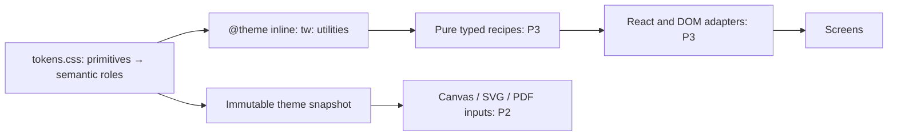

# Design system

`src/design-system/tokens.css` is the authored design-value source. It defines primitive
pigments, complete semantic mappings for `night-paper`, `parchment`, and `velvet`, the
orthogonal Revival type preset, compatibility aliases, and Tailwind's semantic adapter.
P1 preserves the existing appearance; owner decisions in AICAP-28 remain pending.

## Add a token

1. Reuse a semantic role when its purpose and appearance are the same. When existing
   appearances differ, give them distinct roles; do not normalize without an owner decision.
2. Add raw pigments to the primitive block, then map the role in **all three** theme blocks.
   Type, dimension, effect, motion, spectrum, material, and print values belong here too.
   Keep `--ds-*` backing variables even when no utility uses them: renderers need them.
3. Expose a semantic `@theme inline` mapping only when a component needs a utility.
   Use complete literal class strings such as `tw:bg-surface tw:text-ink tw:border-rule`.
   Prefix goes before variants: `tw:hover:bg-surface-hover`. The default Tailwind theme
   namespaces are reset; no default palette, font, radius or shadow vocabulary is available.
4. For concrete renderer colors/fonts, extend `colorRoles`/`fontRoles` in `theme/index.ts`.
   `readTheme().roles` also includes every material/dimensional value. The parser accepts
   authored sRGB hex/RGB and generated degree-based HSL; adding a different color space
   requires extending and testing normalization, not a silent fallback.
5. Run `npm run check:design-tokens`, typecheck, and the relevant tests/browser checks.

## Add a theme or preset

Add a complete mapping for every `--ds-*` role in `tokens.css`, add its ID to the resolver
and public type/validation, and extend the dev showcase and theme-contract browser matrix.
The canonical self-contained resolver is `theme/resolver.js`; `bootstrap.ts` injects its
**raw source** before hydration. Vite uses that same source in the offline shell. Never use
`function.toString()` here: tsx adds function-name helpers, and client/server minification
differs. `resolver.d.ts` describes its boundary without adding another implementation.

Use `setThemePreference('system' | 'night-paper' | 'parchment' | 'velvet')`. Existing device
URLs/storage (`papier`, `pergament`, `samt`, `auto`) remain compatible. Explicit choice wins
over OS appearance. `data-theme` chooses the colors; `data-type` selects the orthogonal
Revival preset. Historical `data-design`/`data-ground` remain while legacy selectors migrate.

`readTheme()` is client-only and returns a deeply frozen snapshot with a revision, concrete
sRGB colors, resolved font stacks, voice spectrum/fallback inputs, material roles and print
roles. Call it after the eager stylesheet is loaded. Imports are SSR-safe. Subscribe with
`subscribeTheme(fn)` and dispose the returned subscription. Reuse a snapshot per drawing
frame; never read computed styles per note. P1 exposes this API; renderer constants/caches
still migrate in P2. Main's existing quiet-moment system-change/reload policy is preserved
through `onSystemThemeChange`; a live showcase swap is not proof of live renderer swaps.

Breakpoints are authored once in the token source's static `@theme` block. Legacy media
queries use `theme(--breakpoint-…)` at build time. JS uses `breakpoint()`/`matchBreakpoint()`;
`below` preserves strict `<` tests and `max` preserves inclusive `<=` tests. Notation geometry
and measured popup/drag positions remain in their existing modules.

## Add a component (P3 contract)

Put framework-free typed class recipes under `design-system/recipes/`. They may import
other recipes, never React, DOM adapters, design bootstrap, theme state or application state.
Both `design-system/react/` and `design-system/dom/` consume those recipes. Preserve all
`data-action`, `data-bind` and ID hooks during screen migration. New primitives explicitly
normalize their own controls; global Preflight is deliberately omitted.

`app.css` is the sole CSS/font entry and owns the order
`theme → legacy → tokens → components → utilities`. Every legacy stylesheet is in the
same layer, base before parchment. Do not add screen-side CSS/font imports. Root SSR links
the generated stylesheet before hydration; the offline shell links it before its entry
script, and the service worker's finalized asset manifest includes generated CSS/fonts.

The dev-only `/dev/design-system` route renders the palette, spectrum and fonts and offers
the switcher. Its module/route are eliminated from production. P3 adds the React/DOM
component comparisons there.

## Guard and legacy baseline

`npm run check:design-tokens` uses TypeScript and PostCSS ASTs. It checks source CSS/TS/JS,
server presentation and authored public SVG/manifest assets. It flags literal colors
(including named colors, template RGB channels and local tuple/channel flow to visual
sinks), font stacks, default-palette/font utilities, arbitrary aesthetic utilities,
screen-context control selectors and forbidden recipe imports. Geometry triples alone and
runtime positioning are permitted. It is conservative local analysis, not an interprocedural
color-flow proof; P2 reviewers must still inspect renderer inputs and external SVG output.

`scripts/design-token-baseline.json` records exact file/kind/context/value/count entries.
Remove resolved entries explicitly. Any new violation **or stale entry** fails. Entries are
also checked against immutable production commit `3c9d43c`, so editing the baseline cannot
admit a new pigment. Local checks cap edits at HEAD's baseline; PR CI caps them at the base
branch. CI fetches history for the production ceiling. Do not regenerate the baseline during
migration; `--initialize-baseline` refuses to overwrite it.

Narrow exceptions: `@font-face` family identities for the seven bundled music/Revival assets
are registrations, not selected font stacks. `safe-svg.ts`'s exact expected Verovio cursor
stylesheet is exempt by SHA-256 of that string; changing it loses the exception. Do not relax
the sanitizer. Static icons/browser metadata and document-processing white flattening remain
visible legacy baseline entries until their respective generation/contract migration.

## Parity roles retained

| Family | Distinct roles retained for current appearance |
| --- | --- |
| DOM/canvas grounds | `surface-sunken/surface/raised/overlay/hover` vs `canvas-surface-sunken/surface/raised/overlay`; `score-stage-top/middle/bottom`; material sheet/card grounds |
| Gold accents | `accent/focus`, `admin-accent`, `transcription-accent`, `accent-offline`, `accent-invitation`, `score-query`, voice 3 / feedback idea; the historical admin system surface remains a named input though its erroneous OS override is removed |
| Gold materials | `material-gold-deep/mid/light` vs `material-wordmark-gold-deep/mid/light`, plus `material-gold-leaf`; stop positions remain separate |
| Ink / whites | `ink`, `material-wordmark-ink`, `score-key-light`, warm/hot light, reading-strip lamp vs `material-paper-lamp`, fibre light/ink |
| Type | DOM body/mono/display/heading/song-title, shorter auth/admin/transcription stacks (`font-auth-*`), canvas text/mono/display, mark/brand/script/music; Revival does not silently change auth/admin or canvas text |
| Controls / spacing | 42px legacy control vs 44px auth/admin/transcription heights; compact controls; existing space scale and score ruler height |
| Radii | Legacy control/card/dialog, square field, admin control, transcription tile/card/dialog, sheet/menu/chip/round |
| State | Disabled base/admin/auth/offline and dimmed-voice opacities remain separate |
| Effects / motion | Material emboss vs menu/admin/focus shadows; switch/fast/normal/slow and transcription/dedication timings; distinct stacking contexts |
| Display / print | Display ink/fonts versus stable print paper/ink and LiberationSerif / LightScoreEngraving asset identities; engraving is unchanged in P1 |

The old offline marker fallback is explicitly mapped to `accent-offline`, so introducing a
complete default accent fixes focus without recoloring that marker. `paper.ts` writes its
procedural texture to `--ds-material-fibre`; the old `--fibre` alias and every material recipe
therefore see the same live image.

## Verification

Run the ticket's `typecheck`, `test`, `build`, and `check:design-tokens` commands. P1's external
evidence lives under `/tmp/aicap-design/evidence/p1/`. Production-built screenshots and computed
styles cover auth, library, roll, staff, ensemble sheet, transcription dialog and admin in both
main themes at desktop/mobile sizes; offline, SSR asset, theme contract and dev HMR checks
complement that matrix. The repository currently has no ladder `docs/agents/verify.md` or
`check:fast`/`check:full`/`verify:app` contract; do not label these commands as those rungs.
