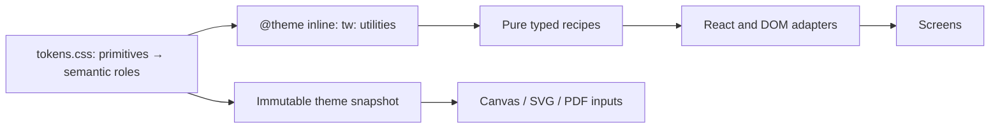

# Design system

`src/design-system/tokens.css` is the authored design-value source. It defines primitive
pigments, shared theme-independent roles and complete varying semantic mappings for `night-paper`, `parchment`, and `velvet`, the
orthogonal Revival type preset and Tailwind's semantic adapter.
The system preserves the existing appearance; owner decisions in AICAP-28 remain pending.

## Add a token

1. Reuse a semantic role when its purpose and appearance are the same. When existing
   appearances differ, give them distinct roles; do not normalize without an owner decision.
2. Name private pigments by origin (for example `--pigment-admin-accent`), then map a shared
   role once in `:root`, or a varying role in every theme block. The theme blocks must have
   identical key sets and must never redefine the shared set.
   Type, dimension, effect, motion, spectrum, material, and print values belong here too.
   Keep `--ds-*` backing variables even when no utility uses them: renderers need them.
3. Expose semantic `@theme inline` mappings. The pixel-valued space scale uses its authored
   numbers (`tw:p-2` is 2px, not Tailwind's default 8px); layer names map via `--z-index-*`
   (`tw:z-dialog`). All authored spacing, layers, sizes and shadows are exposed.
   Use complete literal class strings such as `tw:bg-surface tw:text-ink tw:border-rule`.
   Prefix goes before variants: `tw:hover:bg-surface-hover`. The default Tailwind theme
   namespaces are reset; no default palette, font, radius or shadow vocabulary is available.
4. For concrete renderer colors/fonts, extend `colorRoles`/`fontRoles` in `theme/index.ts`.
   `readTheme().roles` also includes every material/dimensional value. The parser accepts
   authored sRGB hex/RGB and generated degree-based HSL; adding a different color space
   requires extending and testing normalization, not a silent fallback.
5. Run `npm run check:design-tokens`, typecheck, and the relevant tests/browser checks.

## Add a theme or preset

Add one complete varying-role block in `tokens.css` and one entry in
`theme/resolver.js`'s `themeRegistry` (ID, label, URL aliases, storage key, default title start,
color scheme, optional system appearance and menu label policy). Existing translated labels
are retained; `menuLabel: null` keeps Velvet URL-only, as before. New entries without a
translation key use their registry label. Copy an existing theme block to retain its
complete key set, then edit its role values. Shared roles come from `:root`.
There are no legacy theme attributes or compatibility aliases. Components never select a
theme ID. Material recipes use the `material-family` and `color-scheme` token values for their
paper/waves and light material strategies; a new theme chooses these values in its block.

`npm run test:browser:theme-extension` adds a test-only fourth block and registry entry through
Vite transforms, then renders React auth/account/invite/admin/showcase, the main shell/sheets,
and real canvas renderers. It asserts complete resolved roles, the distinctive new accent,
and absence of legacy attributes. No fourth theme is included in production.

The self-contained resolver's raw source, including its registry/helpers, is injected before
hydration; Vite uses the identical serializer for the offline shell. Do not serialize compiled
functions. JS literal inference supplies the public types; no hand-maintained theme union or
second declaration registry exists. The resolver remains safe to import on the server.

Use `setThemePreference('system' | 'night-paper' | 'parchment' | 'velvet')`. Existing device
URLs/storage (`papier`, `pergament`, `samt`, `auto`) remain compatible. Explicit choice wins
over OS appearance. `data-theme` chooses the colors; `data-type` selects the orthogonal
Revival preset. Only `data-theme` selects the theme; `data-start`/`data-title` are independent title drafts.

`readTheme()` is client-only and returns a deeply frozen snapshot with a revision, concrete
sRGB colors, resolved font stacks, spectrum/fallback, material and print roles. Imports are
SSR-safe. It reads each role with `getPropertyValue` using `theme/roles.generated.ts`, generated
from `tokens.css` by the Vite build/watch plugin; the regression test checks exact equality.
It never relies on CSSStyleDeclaration custom-property enumeration. Load the eager CSS first.

Theme API:

- `subscribeTheme(fn, { immediate: true })` delivers the current snapshot and subsequent revisions;
  dispose the returned function. Without `immediate`, delivery starts on the next change.
- `getThemeRevision()` is a cheap key without allocating a snapshot or reading token styles.
- `memoizeByTheme(theme => resource)` returns a zero-argument getter caching one resource per
  revision. Keep one getter per resource; dispose external resources in the owning consumer.
- `theme.color('accent').rgba(alpha)` and `.withAlpha(alpha)` multiply the role's existing alpha;
  `.rgba()` returns a CSS string, `.withAlpha()` a frozen Color. Existing `theme.colors` remains.
- React imports `useTheme` from `design-system/theme/react`; it returns `undefined` during SSR
  and initial hydration, then the cached client snapshot through `useSyncExternalStore`.
- Runtime material writers update their distinct live input, then call
  `notifyThemeMaterialChange()` to invalidate the snapshot/revision and notify subscribers.
  The generated paper texture is a CSS output and does not publish a semantic revision.

Cached reads do not poll DOM attributes; the preference API invalidates synchronously and the
attribute observer handles external attribute edits at its next delivery. Subscriber errors
are isolated with `reportError`; nested invalidation continues the current pass with the
latest snapshot for remaining listeners. There is no quiet-moment preference override API.

Reuse one snapshot per drawing frame; never read computed styles per note. Renderer caches compare revisions; see `renderer-themes.md`. Verify actual playback swaps as
well as the showcase.

Only width thresholds occupy `--breakpoint-*` in the static `@theme` block. The landscape height
is `--viewport-short-landscape-height`, consumed by `theme()` without creating a width variant.
JS uses `breakpoint()` (always a px string; rem converts using root font size) /
`matchBreakpoint()`; `below` preserves strict `<` and `max` inclusive `<=`.
Use `matchBreakpoint('panel', 'below')` / `tw:max-panel:`; there is no `panel-max` token.
Read breakpoints lazily after CSS loads. Notation geometry and measured popup/drag positions
remain in their existing modules.

## Add a component (P3 contract)

Put framework-free typed class recipes under `design-system/recipes/`. They may import
other recipes via `./` or `../recipes/`, plus type-only token/theme imports; runtime theme,
React, DOM adapters and application dependencies are forbidden. Static/dynamic imports and
re-exports all follow this allowlist.
Both `design-system/react/` and `design-system/dom/` consume those recipes. Preserve all
`data-action`, `data-bind` and ID hooks during screen migration. New primitives explicitly
normalize their own controls; global Preflight is deliberately omitted.

`app.css` is the sole CSS/font entry: `theme → fonts → tokens → native → components → utilities`.
It contains imports and Tailwind directives/mappings, with no ordinary component selectors.
There is no legacy layer or legacy stylesheet. `recipes/shell.ts` supplies native route/domain
composition at construction; `dom/main-screen.ts` attaches ID/class slots without DOM scanning.
`native.css` retains global inheritance, generated grounds and native subparts; `stage.css`
retains canvas sizing/compositor hooks; `artwork.css` retains keyframes and the typed ink
interpolation registration. Every retained rule states its reason. Other component CSS is
limited to native/generated parts. Keep element-local inputs (`--written`, `--ded-wait`, voice
colors and measured positions) at their consumer: hoisting their expressions to root freezes
or invalidates them. Their authored dimensions/timings still come from `tokens.css`.

Root SSR and the offline shell link the generated stylesheet before startup. The finalized
service-worker asset manifest includes CSS/fonts and the generated favicon. Browser-installed
SVG/manifest sources live under `design-system/assets`; `scripts/design-assets.mjs` resolves
their default-theme roles for development and builds because external icons cannot inherit
page CSS. Raster brand artwork remains fixed asset data.

The dev-only `/dev/design-system` route renders the palette, spectrum and fonts and offers
the switcher. Its module/route are eliminated from production. P3 adds the React/DOM
component comparisons there.

## Guard: zero baseline

`npm run check:design-tokens` uses TypeScript and PostCSS ASTs. It checks source CSS/TS/JS,
server presentation and authored public SVG/manifest assets. It flags literal colors
(including named colors, template RGB channels and local tuple/channel flow to visual
sinks), font stacks, default-palette/font utilities, arbitrary aesthetic utilities,
screen-context control selectors and forbidden recipe imports. Font/font-family declarations and canvas/style font sinks use an allowlist: a variable,
inherit/initial, or snapshot font (with tokenized sizing in shorthand). Named-color identifiers
are checked throughout CSS values and style/cssText/setProperty/canvas sinks, skipping url(),
var(), font-family, animation-name and content. Recipe dependencies use an allowlist. Outside
the system, computed custom-property reads, legacy dataset theme reads, raw width/height media
queries and direct viewport breakpoint comparisons are baseline-able violations. Unlayered CSS
imports are forbidden outside app.css (root's eager app.css?url link is the explicit boundary).
Arbitrary aesthetics, spacing, dimensions and stacking allow only semantic variable forms
`-(--ds-…)` / `-[var(--ds-…)]`; use named adapter scales first.

Geometry triples alone and measured popup/drag positioning are permitted. This is conservative
local AST/lexical analysis, **not a security boundary** or an interprocedural color-flow proof.
Concatenated/joined strings, cross-module/object-field channels, aliased or reflective DOM
access and arbitrary data flow are not exhaustively resolved. Snapshot-font recognition follows
local `.fonts` access and aliases, not a whole-program type proof. Review renderer inputs and
external SVG output. Do not interpret a green guard as proof of complete theme reactivity.

`scripts/design-token-baseline.json` must contain zero entries. Any non-empty baseline fails,
even when it exactly matches current source. Initialization and merge-new-rules switches are
retired. Fix a violation at its source. Design-system CSS outside `tokens.css` also rejects raw
length/duration literals (including px/rem/em/ms/s/%); zero and 100% are allowed. Token variables
and token-backed calculations are the normal representation. Legacy theme-attribute selectors
are forbidden. Named exceptions are structural rules with reasons, never baseline entries.

`files()` scans authored CSS/TS/JS under src/ and server/, plus public SVG/webmanifest assets.
It skips generated routeTree files and test files, and does not enter scripts/, node_modules/,
build outputs or repository-root index.html/vite.config.ts. These are tooling, generated/test
fixtures and bootstrap/build plumbing rather than product presentation; their emitted CSS /
SSR/offline delivery are covered by build and browser contracts. This scope is a real limit,
so review new presentation-producing tooling and root HTML explicitly.

Named narrow exceptions:

- `paper-noise-geometry`: only formation/flocs/tooth noise tuples in `paper.ts`, interpreted as
  cell counts and amplitude; color tuples at other sinks still fail.
- `notation-stem-shape`: `black` in the existing filled/half stem-shape conditional, not paint.
- `document-white-flattening`: the exact Sharp background property in document preprocessing,
  before grayscale; unrelated to screen or PDF appearance.
- `ink-interpolation-registration`: `@property --written` requires a constant initial percentage;
  108% is completed writing geometry. Its syntax string is CSS registration metadata.

Bundled `@font-face` identities register assets rather than choose stacks. `safe-svg.ts`'s
expected Verovio cursor stylesheet remains exempt by its exact SHA-256; do not relax the sanitizer.
The guard is local AST analysis with the limitations above, not an interprocedural proof.

## Parity roles retained

| Family | Distinct roles retained for current appearance |
| --- | --- |
| DOM/canvas grounds | `surface-sunken/surface/raised/overlay/hover` vs `canvas-surface-sunken/surface/raised/overlay`; `score-stage-top/middle/bottom`; material sheet/card grounds |
| Gold accents | `accent/focus`, `admin-accent`, `transcription-accent`, `accent-offline`, `accent-invitation`, `score-query`, voice 3 / feedback idea; the historical admin system surface remains a named input though its erroneous OS override is removed |
| Gold materials | `material-gold-deep/mid/light` vs `material-wordmark-gold-deep/mid/light`, plus `material-gold-leaf`; stop positions remain separate |
| Ink / whites | `ink`, `material-wordmark-ink`, `score-key-light`, warm/hot light, reading-strip lamp vs `material-paper-lamp`, fibre light/ink |
| Type | DOM body/mono/display/heading/song-title, shorter auth/admin/transcription stacks (`font-auth-*`), canvas text/mono/display, mark/brand/script/music; Revival does not silently change auth/admin or canvas text |
| Controls / spacing | 42px legacy control vs 44px auth/admin/transcription heights; compact controls; existing space scale and score ruler height |
| Radii | Legacy control/card/dialog, square field, admin control, transcription tile/card/dialog, sheet/menu/chip/round |
| State | Disabled base/admin/auth/offline and dimmed-voice opacities remain separate |
| Effects / motion | Material emboss vs menu/admin/focus shadows; switch/fast/normal/slow and transcription/dedication timings; distinct stacking contexts |
| Display / print | Display ink/fonts versus stable print paper/ink and LiberationSerif / LightScoreEngraving asset identities; engraving is unchanged |

The old offline marker fallback is explicitly mapped to `accent-offline`, so introducing a
complete default accent fixes focus without recoloring that marker. `paper.ts` writes its
procedural texture to `--ds-material-fibre-live` and notifies the controller. Paper-theme
`material-fibre` roles use that live input with the authored SVG fallback; velvet keeps `none`.
Material recipes and the renderer accessor consume the chosen semantic role directly.

## Verification

Run `npm run typecheck`, `npm test`, `npm run build`, `npm run check:design-tokens`,
`npm run test:browser:design-system`, `npm run test:browser:theme-extension`,
`npm run test:browser:renderer-themes`, and the isolated authentication/admin browser suites.
Set `BROWSER_EVIDENCE` to an external evidence directory when collecting captures. CI runs the
reusable contracts. Production-built browser checks cover auth, library, roll, staff, ensemble
and account sheets, transcription and admin; renderer checks also compare live token edits
against fresh instances. The repository currently has no ladder `docs/agents/verify.md` or
`check:fast`/`check:full`/`verify:app` contract; these commands do not claim those rungs.

Primitives, parity decisions, adapter examples and browser-check APIs:
[design-primitives.md](design-primitives.md).
