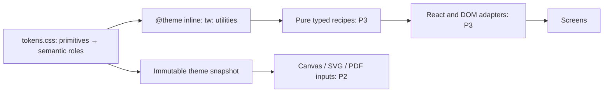

# Design system

`src/design-system/tokens.css` is the authored design-value source. It defines primitive
pigments, shared theme-independent roles and complete varying semantic mappings for `night-paper`, `parchment`, and `velvet`, the
orthogonal Revival type preset, compatibility aliases, and Tailwind's semantic adapter.
P1 preserves the existing appearance; owner decisions in AICAP-28 remain pending.

## Add a token

1. Reuse a semantic role when its purpose and appearance are the same. When existing
   appearances differ, give them distinct roles; do not normalize without an owner decision.
2. Name private pigments by origin (for example `--pigment-admin-accent`), then map a shared
   role once in `:root`, or a varying role in every theme block. The theme blocks must have
   identical key sets and must never redefine the shared set.
   Type, dimension, effect, motion, spectrum, material, and print values belong here too.
   Keep `--ds-*` backing variables even when no utility uses them: renderers need them.
3. Expose semantic `@theme inline` mappings. The pixel-valued space scale uses its authored
   numbers (`tw:p-2` is 2px, not Tailwind's default 8px); layer names map via `--z-index-*`
   (`tw:z-dialog`). All authored spacing, layers, sizes and shadows are exposed.
   Use complete literal class strings such as `tw:bg-surface tw:text-ink tw:border-rule`.
   Prefix goes before variants: `tw:hover:bg-surface-hover`. The default Tailwind theme
   namespaces are reset; no default palette, font, radius or shadow vocabulary is available.
4. For concrete renderer colors/fonts, extend `colorRoles`/`fontRoles` in `theme/index.ts`.
   `readTheme().roles` also includes every material/dimensional value. The parser accepts
   authored sRGB hex/RGB and generated degree-based HSL; adding a different color space
   requires extending and testing normalization, not a silent fallback.
5. Run `npm run check:design-tokens`, typecheck, and the relevant tests/browser checks.

## Add a theme or preset

Add one mapping block for the varying roles in `tokens.css` and one entry in
`theme/resolver.js`'s `themeRegistry` (ID, label, aliases, storage, compatibility attributes,
color scheme and optional system appearance). `ThemeId`, validation, legacy lookups and the
showcase derive from it. Shared roles already come from `:root`. The registry selects the
compatibility look a new theme inherits; **110 historical selectors** still depend on
`data-design` / `data-ground` / `samt`. Removing these selectors and their inherited appearance
is known P6 work, so a registry entry does not independently restyle every legacy component.

The self-contained resolver's raw source, including its registry/helpers, is injected before
hydration; Vite uses the identical serializer for the offline shell. Do not serialize compiled
functions. JS literal inference supplies the public types; no hand-maintained theme union or
second declaration registry exists. The resolver remains safe to import on the server.

Use `setThemePreference('system' | 'night-paper' | 'parchment' | 'velvet')`. Existing device
URLs/storage (`papier`, `pergament`, `samt`, `auto`) remain compatible. Explicit choice wins
over OS appearance. `data-theme` chooses the colors; `data-type` selects the orthogonal
Revival preset. Historical `data-design`/`data-ground` remain while legacy selectors migrate.

`readTheme()` is client-only and returns a deeply frozen snapshot with a revision, concrete
sRGB colors, resolved font stacks, spectrum/fallback, material and print roles. Imports are
SSR-safe. It reads each role with `getPropertyValue` using `theme/roles.generated.ts`, generated
from `tokens.css` by the Vite build/watch plugin; the regression test checks exact equality.
It never relies on CSSStyleDeclaration custom-property enumeration. Load the eager CSS first.

P2/P3 API:

- `subscribeTheme(fn, { immediate: true })` delivers the current snapshot and subsequent revisions;
  dispose the returned function. Without `immediate`, delivery starts on the next change.
- `getThemeRevision()` is a cheap key without allocating a snapshot or reading token styles.
- `memoizeByTheme(theme => resource)` returns a zero-argument getter caching one resource per
  revision. Keep one getter per resource; dispose external resources in the owning consumer.
- `theme.color('accent').rgba(alpha)` and `.withAlpha(alpha)` multiply the role's existing alpha;
  `.rgba()` returns a CSS string, `.withAlpha()` a frozen Color. Existing `theme.colors` remains.
- React imports `useTheme` from `design-system/theme/react`; it returns `undefined` during SSR
  and initial hydration, then the cached client snapshot through `useSyncExternalStore`.
- `onSystemThemeChange(fn)` maintains a set of disposably registered quiet-moment handlers.
  While main registers its handler (unconditionally), OS, storage and explicit choices defer
  the entire DOM/canvas change to its existing quiet-moment reload. The showcase without main
  applies changes live. P2 still must migrate renderer caches before removing that reload.
- Runtime material writers update their distinct live input, then call
  `notifyThemeMaterialChange()` to invalidate the snapshot/revision and notify subscribers.

Reuse one snapshot per drawing frame; never read computed styles per note. Renderer constants
and caches still migrate in P2; a live showcase swap is not proof of reactive renderer swaps.

Only width thresholds occupy `--breakpoint-*` in the static `@theme` block. The landscape height
is `--viewport-short-landscape-height`, consumed by `theme()` without creating a width variant.
JS uses `breakpoint()` (always a px string; rem converts using root font size) /
`matchBreakpoint()`; `below` preserves strict `<` and `max` inclusive `<=`.
Use `matchBreakpoint('panel', 'below')` / `tw:max-panel:`; there is no `panel-max` token.
Read breakpoints lazily after CSS loads. Notation geometry and measured popup/drag positions
remain in their existing modules.

## Add a component (P3 contract)

Put framework-free typed class recipes under `design-system/recipes/`. They may import
other recipes via `./` or `../recipes/`, plus type-only token/theme imports; runtime theme,
React, DOM adapters and application dependencies are forbidden. Static/dynamic imports and
re-exports all follow this allowlist.
Both `design-system/react/` and `design-system/dom/` consume those recipes. Preserve all
`data-action`, `data-bind` and ID hooks during screen migration. New primitives explicitly
normalize their own controls; global Preflight is deliberately omitted.

`app.css` is the sole CSS/font entry and owns the order
`theme → legacy → tokens → components → utilities`. Every legacy stylesheet is in the
same layer, base before parchment. Do not add screen-side CSS/font imports. Root SSR links
the generated stylesheet before hydration; the offline shell links it before its entry
script, and the service worker's finalized asset manifest includes generated CSS/fonts.

The dev-only `/dev/design-system` route renders the palette, spectrum and fonts and offers
the switcher. Its module/route are eliminated from production. P3 adds the React/DOM
component comparisons there.

## Guard and legacy baseline

`npm run check:design-tokens` uses TypeScript and PostCSS ASTs. It checks source CSS/TS/JS,
server presentation and authored public SVG/manifest assets. It flags literal colors
(including named colors, template RGB channels and local tuple/channel flow to visual
sinks), font stacks, default-palette/font utilities, arbitrary aesthetic utilities,
screen-context control selectors and forbidden recipe imports. Font/font-family declarations and canvas/style font sinks use an allowlist: a variable,
inherit/initial, or snapshot font (with tokenized sizing in shorthand). Named-color identifiers
are checked throughout CSS values and style/cssText/setProperty/canvas sinks, skipping url(),
var(), font-family, animation-name and content. Recipe dependencies use an allowlist. Outside
the system, computed custom-property reads, legacy dataset theme reads, raw width/height media
queries and direct viewport breakpoint comparisons are baseline-able violations. Unlayered CSS
imports are forbidden outside app.css (root's eager app.css?url link is the explicit boundary).
Arbitrary aesthetics, spacing, dimensions and stacking allow only semantic variable forms
`-(--ds-…)` / `-[var(--ds-…)]`; use named adapter scales first.

Geometry triples alone and measured popup/drag positioning are permitted. This is conservative
local AST/lexical analysis, **not a security boundary** or an interprocedural color-flow proof.
Concatenated/joined strings, cross-module/object-field channels, aliased or reflective DOM
access and arbitrary data flow are not exhaustively resolved. Snapshot-font recognition follows
local `.fonts` access and aliases, not a whole-program type proof. Review renderer inputs and
external SVG output. Do not interpret a green guard as proof of complete theme reactivity.

`scripts/design-token-baseline.json` records exact file/kind/context/value/count entries.
Remove resolved entries explicitly. Any new violation **or stale entry** fails. Entries are
also checked against immutable production commit `3c9d43c`, so editing the baseline cannot
admit a new pigment. Local checks cap edits at HEAD's baseline; PR CI caps them at the base
branch. CI fetches history for the production ceiling. Do not regenerate the baseline during migration; `--initialize-baseline` refuses to overwrite
it. After strengthening a guard rule, `node scripts/check-design-tokens.mjs --merge-new-rules`
can add exact entries/counts only for that rule's newly versioned detection, and only when
present at `3c9d43c`. It records the rule versions; later runs cannot revive removed entries at
the same version. The ordinary guard checks both immutable membership and reference growth.
Do not hand-edit versions to admit new work. Renaming a function containing a legacy color
changes its context and makes it NEW: remove the color rather than rebasing its baseline.

`files()` scans authored CSS/TS/JS under src/ and server/, plus public SVG/webmanifest assets.
It skips generated routeTree files and test files, and does not enter scripts/, node_modules/,
build outputs or repository-root index.html/vite.config.ts. These are tooling, generated/test
fixtures and bootstrap/build plumbing rather than product presentation; their emitted CSS /
SSR/offline delivery are covered by build and browser contracts. This scope is a real limit,
so review new presentation-producing tooling and root HTML explicitly.

Narrow exceptions: `@font-face` family identities for the seven bundled music/Revival assets
are registrations, not selected font stacks. `safe-svg.ts`'s exact expected Verovio cursor
stylesheet is exempt by SHA-256 of that string; changing it loses the exception. Do not relax
the sanitizer. Static icons/browser metadata and document-processing white flattening remain
visible legacy baseline entries until their respective generation/contract migration.

## Parity roles retained

| Family | Distinct roles retained for current appearance |
| --- | --- |
| DOM/canvas grounds | `surface-sunken/surface/raised/overlay/hover` vs `canvas-surface-sunken/surface/raised/overlay`; `score-stage-top/middle/bottom`; material sheet/card grounds |
| Gold accents | `accent/focus`, `admin-accent`, `transcription-accent`, `accent-offline`, `accent-invitation`, `score-query`, voice 3 / feedback idea; the historical admin system surface remains a named input though its erroneous OS override is removed |
| Gold materials | `material-gold-deep/mid/light` vs `material-wordmark-gold-deep/mid/light`, plus `material-gold-leaf`; stop positions remain separate |
| Ink / whites | `ink`, `material-wordmark-ink`, `score-key-light`, warm/hot light, reading-strip lamp vs `material-paper-lamp`, fibre light/ink |
| Type | DOM body/mono/display/heading/song-title, shorter auth/admin/transcription stacks (`font-auth-*`), canvas text/mono/display, mark/brand/script/music; Revival does not silently change auth/admin or canvas text |
| Controls / spacing | 42px legacy control vs 44px auth/admin/transcription heights; compact controls; existing space scale and score ruler height |
| Radii | Legacy control/card/dialog, square field, admin control, transcription tile/card/dialog, sheet/menu/chip/round |
| State | Disabled base/admin/auth/offline and dimmed-voice opacities remain separate |
| Effects / motion | Material emboss vs menu/admin/focus shadows; switch/fast/normal/slow and transcription/dedication timings; distinct stacking contexts |
| Display / print | Display ink/fonts versus stable print paper/ink and LiberationSerif / LightScoreEngraving asset identities; engraving is unchanged in P1 |

The old offline marker fallback is explicitly mapped to `accent-offline`, so introducing a
complete default accent fixes focus without recoloring that marker. `paper.ts` writes its
procedural texture to `--ds-material-fibre-live` and notifies the controller. Paper-theme
`material-fibre` roles use that live input with the authored SVG fallback; velvet keeps `none`.
The old `--fibre` alias and material recipes resolve the chosen role. Compatibility aliases
are defined once on `:root` and freeze there: per-subtree themes do not re-theme legacy aliases.

## Verification

Run the ticket's `typecheck`, `test`, `build`, and `check:design-tokens` commands. P1's external
evidence lives under `/tmp/aicap-design/evidence/p1/`. Production-built screenshots and computed
styles cover auth, library, roll, staff, ensemble sheet, transcription dialog and admin in both
main themes at desktop/mobile sizes; offline, SSR asset, theme contract and dev HMR checks
complement that matrix. The repository currently has no ladder `docs/agents/verify.md` or
`check:fast`/`check:full`/`verify:app` contract; do not label these commands as those rungs.

P1 review-fix evidence and per-finding receipts: `/tmp/aicap-design/evidence/p1-fix/report.md`.
